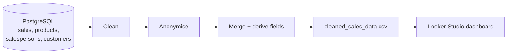

<p align="center"></p>

A complete analysis workflow on sales data: pull it from **PostgreSQL**, clean it in **Python**, and present it in an interactive **Looker Studio** dashboard.

**[View the dashboard](https://lookerstudio.google.com/reporting/1eb52f32-8a56-465d-8048-4377e6392989)**

## The workflow



`script/e2e_data_pipeline.py` does it in seven steps:

1. **Connect** to the PostgreSQL database.
2. **Load** the sales, product, salesperson and customer tables.
3. **Clean** the sales data: remove rows with invalid amounts or quantities, fix records where the unit price is below the unit cost, and estimate missing or zero costs.
4. **Anonymise** sensitive data: product names and categories, salesperson names and customer names are replaced using Faker.
5. **Merge** the tables into one and drop the keys that are no longer needed.
6. **Add derived fields** for analysis.
7. **Save** the result as `cleaned_sales_data.csv`, the dashboard's data source.

## Run it

```bash
pip install pandas sqlalchemy faker psycopg2-binary
python script/e2e_data_pipeline.py
```

Set the database connection details at the top of the script to your own before running.

## Layout

| Folder | Contents |
|---|---|
| `script/` | The pipeline script |
| `dashboard/` | Link to the Looker Studio dashboard |
| `datasets/`, `docs/` | Reserved for data and documentation |

---

<sub>Part of <b>the silent data</b> · Kennedy Njoroge</sub>
